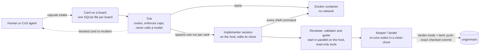

# Capsule Corp

Self-hosted AI software factory for one developer on macOS: Claude Code agents build, review and land work from a kanban board, and nothing reaches `main` without an independent review, blind tests and landing gates.

[](LICENSE)

<!-- TODO: screenshot or GIF (docs/demo.png). Real capture only. -->

> **Read this first.** This is a pre-alpha preview. It is an early preview, `v0.2.0-alpha.1`, not a finished product. No app built by the factory has been accepted by its owner yet. A restructure into smaller, modular parts is planned, so the layout, commands and interfaces will change. Read [docs/KNOWN-ISSUES.md](docs/KNOWN-ISSUES.md) before you install. The system targets macOS and was built by one person for their own machine, so some paths, names and defaults are still personal. The repository is released under the [MIT licence](LICENSE). See [Status and limits](#status-and-limits).

## Install

Clone this repository, then run:

```bash
cd capsule-corp && ./install.sh --yes
```

Then build the worker image once (about 40 GB of disk, and it takes hours); see [Requirements](#requirements).

Capsule Corp is a lightweight software factory for a solo maintainer. One chief-of-staff (CoS) agent files work as cards on a board. A background tick then runs each card through an implementer that runs every command in a no-network Docker container, and host-run read-only reviewers (reviewer, validator, guide), so you only step in for short unblocking bursts. Nothing lands on `main` until an independent reviewer and a validator have checked it, and the system records every time a human had to intervene.

It is built around three goals: **lightweight** (one maintainer, small machines), **model-robust** (thin machinery around the models, so a new model does not break it) and, later, **provider-agnostic** (each role picks its own runner, model and key). Today every role runs on Claude Code. See [docs/PRODUCT.md](docs/PRODUCT.md) for the principles.

## How it works



- **Boards and cards.** Work is a card on a board. Every status change goes through one transition table in `capsule/db.py`.
- **Tick.** One tick per board is the only writer of that board. It routes cards, enforces limits and spawns runs. It never calls a model itself.
- **No-network implementer commands.** The tick starts a Docker container for the implementer (`docker/base`, `--network=none`). The model session (`claude -p`, started by `capsule/worker.py`) runs on the host in the implementer's own git clone and edits files there. Its edits are limited to that clone; Capsule does not confine its file reads. Every shell command it runs goes into the container through the `mcp__capsule__exec` tool. The reviewer, validator and guide start in parallel after it and run on the host with read-only tools (`HostRunner`), not in containers.
- **Roles.** Implementer, reviewer, validator, guide, Korin (incident post-mortems), security reviewer, lookout, advisor (a packet of rework, incidents and overrides in; ranked contract proposals out), auditor (an audit of board metrics; at most 3 proposals; both are run by hand, no scheduled job runs them yet) and blind tester (writes acceptance tests from a card's acceptance text, without seeing the code). Each has a contract in `contracts/`.
- **Landing.** The lander runs the board's `lander.gates` first, in a throwaway clone, and then re-runs the test suites (the example config lists mutation, size, simplicity, ruff and Linux-portability checks from `tests/`). In `land` mode it pushes the exact commit it checked. The default is a dry run. An optional second check asks GitHub for the Verify workflow's result on the pushed commit (`lander.ci_watch`, off unless you set it).
- **Humans.** `capsule human` records each intervention. Every crash, hang or override opens an incident, and an incident closes only through a gate.
- **Rules.** The reliability rules in [docs/ZENKAI.md](docs/ZENKAI.md) bind every agent.

The deeper picture is in [docs/ARCHITECTURE.md](docs/ARCHITECTURE.md). The full architecture set (overview, one page per component, file inventory) starts at [docs/architecture/overview.md](docs/architecture/overview.md).

## Requirements

- macOS 14 or newer, with Homebrew (the installer never installs it) and `launchctl` (the install scripts refuse to run elsewhere; the harness itself is Python and may run on Linux, which is untested).
- OrbStack (the default Docker engine), running; Docker Desktop also works ([worker-runner-and-images](docs/architecture/components/worker-runner-and-images.md), "Docker engine switch").
- A worker image you build yourself, once: `docker/build-base.sh base && docker/build-base.sh python`. It needs about 40 GB of free disk and takes hours; there is no hosted download. The build records what it made in `$CAPSULE_HOME/images.lock`, which the tick and `capsule check` read ([docs/SETUP.md](docs/SETUP.md), section 7).
- Python 3.11 or newer (the harness core uses the standard library; `./install.sh` finds one or, with your yes, installs it through `uv`).
- git 2.40 or newer (the Brewfile installs it; `capsule doctor` reports older git).
- About 25 GB of free disk, 40 GB until the worker image is built.
- A Claude Code login on the machine. The workers use your Claude subscription login, not an API key stored in the repo.
- A GitHub account and `gh` login for the repositories the factory works on.
- Optional: Slack (notifications and phone answers).

## Quick start

All commands below exist in this repo. The full step-by-step guide, with a verify command for each step, is [docs/SETUP.md](docs/SETUP.md).

New machine (macOS)? `./install.sh --dry-run` lists every setup step and changes nothing; `./install.sh --yes` runs them and ends with `capsule doctor` (see [docs/SETUP.md](docs/SETUP.md), "The one-command install"). `--capsule-home DIR` keeps the factory's state somewhere other than `~/.local/share/capsule`. The installer itself writes only to that folder, `~/Library/LaunchAgents` and `~/.local/bin`; the dashboards, Docker Desktop's first launch and the `claude` and `gh` logins are still yours to do (it prints what to run). Its exit code is doctor's, or 1 if any step failed.

```bash
git clone <this repo> capsule-corp && cd capsule-corp
./install.sh --dry-run                                   # print every setup step, change nothing
./install.sh                                             # set this Mac up (add --yes to take the defaults)
```

`./install.sh` finds a Python 3.11 or newer (or offers to install one); a stock Mac's `python3` is 3.9, too old for capsule. It also writes the `capsule` launcher to `~/.local/bin` (it prints the `PATH` line to add if that folder is not on it), and the commands below use it.

```bash
capsule --help                                          # the harness CLI
capsule check --board <board>                           # read-only preconditions: config, docker, image, claude
bin/capsule-tick.sh start <board>                       # start a board's tick under launchd (also: stop, restart, status)
capsule status                                          # what runs, what needs you, what is stuck
capsule card <board> <task> history                     # one card's event timeline: why it holds or failed
```

Before swapping the model behind a role, replay that role's golden set against it. This makes real model calls; only the validator has a golden set so far:

```bash
capsule golden run validator --route claude/<model> --min-pass 1.0
```

File a card on a board (the tick picks it up on its next pass):

```bash
capsule intake <board> --title "Short title" --body-file card.md
```

A board needs a `config.json` under `$CAPSULE_HOME/boards/<board>/` (default `CAPSULE_HOME` is `~/.local/share/capsule`). Create one with `capsule board new <name> --repo <url>`, after `./install.sh` (it ends with `capsule doctor`, which you can rerun any time; see [docs/SETUP.md](docs/SETUP.md)). Then `capsule board tick <name>` sets up that board's tick job (the harness checkout and the launchd plist; it never runs `launchctl`) and prints the command that starts it.

Run the tests:

```bash
python3 -m unittest discover -s capsule/tests -t .
python3 -m unittest discover maintenance/tests
```

The lint tests (`test_ruff_gate*`, the tick merge-gate test) need ruff 0.17.4: put `ruff` on PATH or run `uvx ruff@0.17.4 --version` once online so uv caches it. Without ruff they skip with "ruff not available".

## Local UIs

Optional: none of this is needed to run the tick. `./install.sh` does not start the dashboards. To bring them up (needs Docker running), run `bin/capsule-ui-up` (`--dry-run` shows what it would do); it prints the URLs below once they answer. See [docs/SETUP.md](docs/SETUP.md), section 9.

Every local web UI gets a name `cc.<name>.localhost`. Chrome resolves `*.localhost` to 127.0.0.1, so no hosts-file edit is needed. A Caddy front door (`observability/docker-compose.yml`, routes in `observability/caddy/Caddyfile`) listens on 127.0.0.1:80 only.

| URL | What it is |
|---|---|
| `http://cc.grafana.localhost` | Grafana dashboards and alerts: anonymous read-only viewer; edits need the `admin` login |
| `http://cc.secrets.localhost` | Infisical, the self-hosted secrets server; keeps its own login. Only exists when the `infisical` secrets backend is on (compose profile `secrets`) |

For terminal inspection use `capsule status` and `capsule board`.

## Secrets

Secrets never live in git. Callers use one thin wrapper, `bin/capsule-secret` (`get`, `run`, `export`, `check`, `backend`), and never learn where the values sit. The backend comes from `CAPSULE_SECRETS_BACKEND`: `file` (`$CAPSULE_HOME/secrets.env`, refused unless mode 0600), `infisical` (a self-hosted [Infisical](https://infisical.com) server, started with compose profile `secrets`) or `env` (the process environment, for CI). Unset, a machine that already has an Infisical config keeps using it and any other machine uses `file`. Each `env.example` or `env.template` lists key names only. A gitleaks scan runs on every pull request. Usage: `bin/capsule-secret --help`; what leaves the machine: [docs/EGRESS.md](docs/EGRESS.md).

## Documentation map

| Doc | Read it for |
|---|---|
| [docs/SETUP.md](docs/SETUP.md) | Install on a fresh Mac, with verify commands |
| [docs/ARCHITECTURE.md](docs/ARCHITECTURE.md) | One-page overview of the parts |
| [docs/PRODUCT.md](docs/PRODUCT.md) | North star, product boundary, single-pane rule |
| [docs/EGRESS.md](docs/EGRESS.md) | What leaves the machine, and where it goes |
| [docs/ZENKAI.md](docs/ZENKAI.md) | The reliability rules every agent follows |
| [CONTRIBUTING.md](CONTRIBUTING.md) | Set up, run the tests and the public lint, commit style |
| [CHANGELOG.md](CHANGELOG.md) | What changed |
| [docs/KNOWN-ISSUES.md](docs/KNOWN-ISSUES.md) | Open problems, with workarounds |
| [docs/RELEASE.md](docs/RELEASE.md) | Supply-chain and release deferrals |
| `contracts/` | The contract each role works under |

## Layout

| Path | What it is |
|---|---|
| `capsule/` | The harness: tick, workers, review, landing, incidents (`capsule --help`) |
| `contracts/` | Role contracts read by workers |
| `docker/base/`, `docker/stacks/` | The worker container image: base, stack and project layers |
| `bin/` | Operator scripts: `bin/capsule-tick.sh`, `bin/capsule-secret`, `bin/hoi-poi.sh` (cold start and shutdown), `bin/capsule-park.sh` |
| `observability/` | Compose stack (Postgres, Loki, Fluent Bit, Grafana, Caddy; Infisical only with profile `secrets`) and provisioned dashboards |
| `launchd/templates/` | launchd job templates; `__HOME__` is replaced when installed |
| `maintenance/` | Scheduled jobs, reports and their tests |
| `tests/` | Shell and Python suites, plus the mutation, size and simplicity checks CI relies on |

## Status and limits

Honest summary:

- **Live:** the tick-based factory has run the maintainer's own boards. Auto-landing is on for the `capsule-corp` board (`lander.mode: land`); the shipped example configs, and any board without that setting, are a dry run. Cards have landed on `main` through capsule runs on the maintainer's machine. Check what runs now with `capsule status`.
- **Pre-alpha preview.** Interfaces change without notice. Open problems are listed in [docs/KNOWN-ISSUES.md](docs/KNOWN-ISSUES.md).
- **Sandbox for read-only roles is partial.** `capsule/runners/seatbelt.py` renders a macOS `sandbox-exec` profile for the light runner tier. The tier is built and tested but off by default (`redesign.light_runner`, `false` in `capsule/config.example.json`); with it off, reviewers run on the host with read-only tools.
- **Single machine, single maintainer.** It is built for one macOS host. There is no multi-user mode and no hosted version.
- **Claude only, for now.** Routing is per role in the board config, but the only implemented runner is Claude Code (`capsule/models/claude.py`). Other providers are planned.
- **Defaults are neutral settings.** An install sets its own name and paths in `$CAPSULE_HOME/host.json`: `owner.name`, `owner.copyright`, `config_dir`, `vault.path` and `vault.skill_root`, and `launchd.label_prefix` (default `dev.capsule`). Key names and env overrides are in [docs/SETUP.md](docs/SETUP.md); review the example board configs before installing.
- **Licence.** Capsule is licensed under the MIT licence in [LICENSE](LICENSE). Third-party components keep their own licences, and their notices live in [docs/licenses/NOTICE.md](docs/licenses/NOTICE.md). A licence scan (`maintenance/notice_gen.py --scan` and `--check`) runs in CI; it is advisory for now.
- **No package installs for cards yet.** The implementer container has no network and cannot install pip or npm packages, so a repo the factory works on should be standard-library only for now (see [docs/SETUP.md](docs/SETUP.md), "Limits for first testers").
- **Not verified for strangers.** The install path has been exercised on the author's machines and in tests, not on a stranger's fresh Mac.
