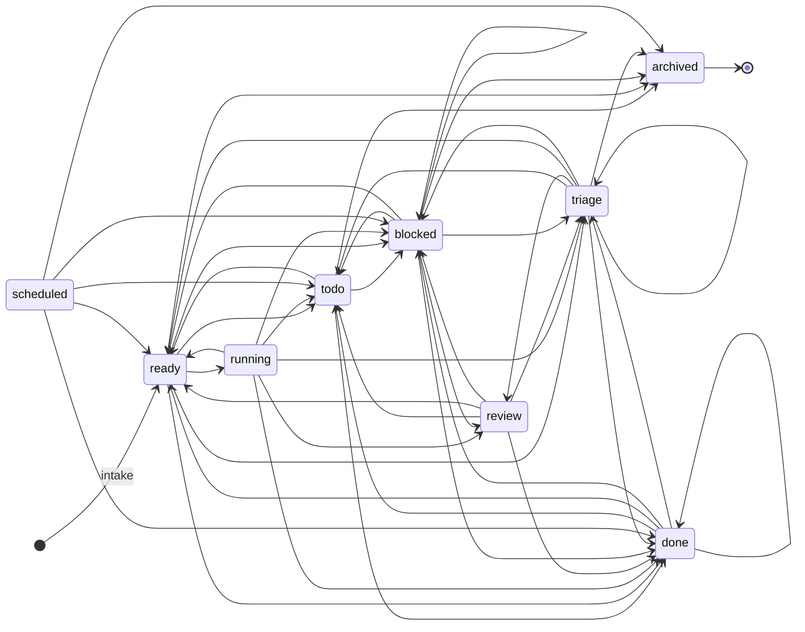

# Data model

The board is one SQLite file. This page lists its tables and columns, the card statuses and the
moves between them, and the main `guard_state` keys. Everything here was read from
`capsule/board_schema.sql` and `capsule/db.py` at commit `3acc797a7` (2026-11-27). Status words
and column names are exact. Meanings come from the code that reads and writes each column.

## TL;DR

- One board is one file: `$CAPSULE_HOME/boards/<board>/kanban.db`. Only that board's tick writes it.
- A card is a row in `tasks`. Its `status` changes only through `db.transition`, which checks the
  table `TRANSITIONS`.
- Every attempt is a row in `task_runs`. Every change is a row in `task_events`.
- Flags and timers live in `guard_state`, a key-value table with a version for compare-and-set.

## Where the files live

```
$CAPSULE_HOME/                      default: ~/.local/share/capsule  (capsule/paths.py)
  boards/<board>/
    kanban.db                       the board (SQLite, WAL mode)
    config.json                     the board config, re-read every pass
    spool/<run_id>/                 one folder per run
    intake/  human/                 one JSON file per filed card or human verb
    work/<branch-slug>/             one clone per epic
    outbox.log                      the file sender of the outbox
```

The file is created by `db.create_board(path)`: it runs the base schema `board_schema.sql`, then
`db.migrate`, which adds Capsule's columns and tables. `migrate` is additive and safe to repeat.
The connection uses WAL, `synchronous=FULL`, foreign keys on and a 120 s busy timeout.

## Card statuses and moves

`TRANSITIONS` in `capsule/db.py` maps each **target** status to the set of statuses it may be
entered **from**. `transition(conn, id, to, frm=...)` raises `ValueError` when a `frm` is not
legal. It is the only writer of `tasks.status`. The caller writes the event that says why.

| Status | Meaning | Enters from | What moves a card in |
|---|---|---|---|
| `todo` | Waiting: a parent card is open, or the card is held for a dependency. | `ready`, `running`, `review`, `blocked`, `triage`, `scheduled`, `done` | `blocks.block` with kind `dependency`; a claim rejected because a parent is open (`lease.py`) |
| `ready` | Can be dispatched when a seat, a runner tier and the caps allow. This is the status of a new card. | `todo`, `running`, `review`, `blocked`, `triage`, `scheduled`, `done` | intake; the parents finish (`promote_ready`); a stale or stopped run is released (`lease.release_stale`, `tick_runs.py`); a human `reset` or `unblock` |
| `running` | A worker holds the claim. | `ready` only | `lease.claim`, when the tick dispatches the card |
| `review` | The implementer reported `done`; reviewers judge. | `running`, `blocked`, `triage` | the implementer's report is applied (`tick.py`); a human `accept`; a reviewer re-run |
| `blocked` | Held for a human or for a condition. `block_kind` says why. | `todo`, `ready`, `running`, `review`, `blocked`, `triage`, `scheduled`, `done` | `blocks.block`; `park` and `stop` verbs |
| `triage` | Held and needs a judgement: the failure limit was reached, a contradiction, a runaway, or the same block came back. | `ready`, `running`, `review`, `blocked`, `triage`, `done` | `blocks.record_failure` at the limit; `blocks.block` when a block recurs twice (`BLOCK_RECURRENCE_LIMIT`); contradiction, runaway and restart code; a worker's `decision` document (`spool.py`) |
| `done` | Reviewed and passed. The landing step reads `done` cards. | `todo`, `ready`, `running`, `review`, `blocked`, `triage`, `scheduled`, `done` | the review round passes; the lander records a landing (`landing.py`); a human `close`; epic sync |
| `archived` | Taken out of its lane for good. Nothing is deleted. | `todo`, `ready`, `blocked`, `triage`, `scheduled` | the `archive` human verb (`blocks.py`) |
| `scheduled` | Listed in the table and in `REASSIGNABLE_STATUSES`, but it has **no key** in `TRANSITIONS`. No code in `capsule/` moves a card into it today. | none | none |

Facts that follow from the table:

- A card enters `running` only from `ready`. A card enters `review` only from `running`, `blocked`
  or `triage`.
- `archived` is terminal: no status lists it as a source.
- `blocked`, `triage` and `done` may move to themselves (the code uses this to change the columns of
  an already held card).



(The diagram is generated from `TRANSITIONS`: an arrow `A --> B` means `A` is in `TRANSITIONS["B"]`.
`scheduled` appears only as a source, and the `intake` arrow from the start point is not a table
entry: a new card is inserted with status `ready`.)

## Tables

Base tables come from `capsule/board_schema.sql` (a schema inherited from an earlier prototype,
pinned by a test, never edited). `ADDED_COLUMNS` and `ADDED_TABLES` in `capsule/db.py` add the rest.
Times are Unix seconds (INTEGER). JSON is stored as TEXT.

### tasks (the cards)

| Column | Type | Meaning |
|---|---|---|
| `id` | TEXT PK | `t_` plus 8 hex digits. |
| `title`, `body` | TEXT | The card text. The body is the work order the implementer reads. |
| `assignee` | TEXT | A name from the config `assignees` map; it routes to a role. A card with no routable assignee never dispatches. |
| `status` | TEXT | One of the statuses above. |
| `priority` | INTEGER | Order hint (default 0). |
| `created_by`, `created_at` | TEXT, INTEGER | Who filed it and when. `new_task` writes `capsule`. |
| `started_at`, `completed_at` | INTEGER | First start; set when the card goes `done`. |
| `workspace_kind`, `workspace_path` | TEXT | Inherited columns (default `scratch`). Capsule keeps clones under `work/`. |
| `branch_name` | TEXT | The epic branch of the card. Indexed. |
| `claim_lock`, `claim_expires`, `worker_pid` | TEXT, INTEGER, INTEGER | The claim: a compare-and-set lock with a time limit, and the worker's pid. Cleared by `CLEAR_CLAIM`. |
| `last_heartbeat_at`, `max_runtime_seconds` | INTEGER | Worker liveness and the per-card runtime cap. |
| `current_run_id` | INTEGER | The `task_runs.id` of the run now in flight, or NULL. |
| `consecutive_failures` | INTEGER | Inherited counter. Capsule counts failures in `failure_count` instead. |
| `failure_count` | INTEGER | Failed runs since the last reset. At `caps.failure_limit` the card goes to `triage`. (added) |
| `failure_reset_at` | INTEGER | When a human last reset the count. (added) |
| `last_failure_error` | TEXT | Short text of the last failure. |
| `block_kind` | TEXT | Why a card is held. One of `VALID_BLOCK_KINDS` in `capsule/blocks.py` (`dependency`, `needs_input`, `capability`, `transient`, `review_infra`, `contradiction_loop`, `spec_stale`, `invalid_document`, `epic_sync_conflict`, `epic_sync_error`), or a code-set kind such as `parked`, `runaway`. |
| `block_recurrences` | INTEGER | How often the same block came back. At 2 (`BLOCK_RECURRENCE_LIMIT`) the card goes to `triage`. |
| `risk_class`, `tier` | TEXT | The runner tier: `strong`, `light` or `mac`. `tier` follows `risk_class` unless given. (added) |
| `file_set` | TEXT (JSON list) | The files the card may touch. (added) |
| `short_name`, `name_source`, `number` | TEXT, TEXT, INTEGER | The name on the board, who named it (`human` or NULL), and a per-board number. (added) |
| `request_needs` | TEXT | What a worker's `decision` card needs (for example `role:guide`). (added) |
| `check_cmd`, `check_expect` | TEXT | The card's own check command and text its output must contain (card fields, `capsule/card_fields.py`). (added) |
| `size_tag`, `risk_flags`, `workload`, `passes` | TEXT, TEXT (JSON list), TEXT, INTEGER | Card fields: size, risk flags, workload (`upkeep`, `product`, `research`), and the count of passes. (added) |
| `waits_on_branch` | TEXT | The epic this card waits on; cleared when that epic lands (`blocks.promote_ready`). (added) |
| `blind_commit` | TEXT | The blind commit whose tests landed with the card. (added) |
| `contract_ref` | TEXT | Declared in `ADDED_COLUMNS`; no code in `capsule/` reads it today. (added) |

The base table also holds columns the inherited schema defines and Capsule does not use:
`project_id`, `tenant`, `result`, `idempotency_key`, `workflow_template_id`, `current_step_key`,
`skills`, `model_override`, `provider_override`, `reasoning_effort`, `max_retries`, `goal_mode`,
`goal_max_turns`, `session_id`.

### task_runs (one row per attempt)

| Column | Type | Meaning |
|---|---|---|
| `id` | INTEGER PK | The "run pk". `tasks.current_run_id` and `task_events.run_id` point here. |
| `run_id` | TEXT, unique | The run's uuid; also the spool folder name. (added) |
| `task_id` | TEXT | The card. |
| `profile` | TEXT | The role: `implementer`, `reviewer`, `validator`, `guide`, `korin`, `blind-tester`, `security`. |
| `step_key` | TEXT | Unused by the kernel. |
| `status` | TEXT | `running`, `done`, `blocked`, `crashed`, `timed_out`, `failed` or `released`. |
| `claim_lock`, `claim_expires`, `worker_pid`, `max_runtime_seconds`, `last_heartbeat_at` | mixed | The claim of the run, as on `tasks`. |
| `started_at`, `ended_at` | INTEGER | Start and end. NULL `ended_at` means the run is live. |
| `outcome` | TEXT | `completed`, `blocked`, `crashed`, `timed_out`, `spawn_failed`, `gave_up`, `reclaimed`, `failed`, or NULL while running. |
| `summary`, `metadata`, `error` | TEXT | Short result text, extra JSON, and the error text. |
| `provider`, `account`, `model`, `runner` | TEXT | Which route and runner tier ran it. (added) |
| `tokens_in`, `tokens_out`, `tokens_cache_read`, `tokens_cache_write` | INTEGER | Token counts. (added) |
| `handoff`, `resumed_from`, `session_id` | TEXT | Checkpoint text, the run it resumed, and the model session a quiet stop resumes. (added) |
| `attempts`, `error_class` | INTEGER, TEXT | Model-call attempts and the failure class (for example `invalid_output`, `transient`, `fatal`). (added) |

### task_events (the audit trail)

| Column | Type | Meaning |
|---|---|---|
| `id` | INTEGER PK | Increasing. The incident watermark is an event id. |
| `task_id` | TEXT | The card (`eval` for board-level checks). |
| `run_id` | INTEGER | The `task_runs.id`, when the event belongs to a run. |
| `kind` | TEXT | An event kind. The allowed kinds and payload keys are in `capsule/event_kinds.py`. |
| `payload` | TEXT (JSON) | The fields of that kind. A run's uuid is always added as `run_id`. |
| `created_at` | INTEGER | Time. |

### incidents (Korin's record)

| Column | Meaning |
|---|---|
| `id`, `board`, `task_id`, `run_id` | Incident id (`inc_...`), the board, and the card and run it came from. |
| `kind` | One of `INCIDENTS_KIND`: `crash`, `hang`, `silent_failure`, `review_infra`, `invalid_document`, `contradiction`, `human_intervention`, `override`, `escaped_bug`, `repeat`, `two_dispatchers`, `main_checkout_write`, `lost_card_state`, `runaway`. |
| `status` | One of `INCIDENTS_STATUS`: `open`, `postmortem`, `fix_pending`, `closed`, `superseded`. |
| `opened_at`, `closed_at` | Times. |
| `evidence` | JSON list of evidence paths and events. |
| `fingerprint`, `root_key`, `repeat_of` | Same-cause matching. A repeat of a closed fingerprint within 30 days is the headline number. |
| `root_cause`, `lesson`, `mitigation`, `enforcer`, `recurrence_test` | The post-mortem fields Korin fills. |
| `decision_row`, `decision_row_text`, `confidence` | The decision row and Korin's confidence. |
| `fix_card`, `korin_task`, `note_path` | The blocked fix card, the Korin run card, and the vault note path. |
| `role`, `main_sha`, `closure`, `description` | The role involved, the `main` sha at the time, how it closed (`watch`, `history`, `duplicate`, `watch_failed`), and an operator's prose. |

### Other tables

| Table | Purpose and key columns |
|---|---|
| `task_links` | Parent and child cards: `parent_id`, `child_id` (primary key together). A card with an open parent waits. |
| `task_comments` | `task_id`, `author`, `body`, `created_at`. |
| `task_attachments` | Files attached to a card: `task_id`, `filename`, `stored_path`, `content_type`, `size`, `uploaded_by`, `created_at`. |
| `kanban_notify_subs` | Inherited chat subscriptions per card (`platform`, `chat_id`, `thread_id`, `last_event_id`, and more). |
| `outbox` | Messages to send: `channel`, `thread_key`, `body`, `created_at`, `attempts`, `delivered_at`, `last_error`, `status` (default `pending`). |
| `outbox_key` | `outbox_id` to `dedup_key`, so a message is queued once. |
| `slack_msg` | One Slack message per `key`: `kind`, `channel`, `ts`, `state` (default `open`), `text`, `posted_at`, `updated_at`, `reminded_at`. |
| `thread_owner` | `(channel, thread_ts)` to `task_id` and `role`: who owns a Slack thread. |
| `requests` | The documents a worker filed: `run_id`, `claim_lock`, `verb`, `schema`, `body`, `status`, `error`, `created_at`. |
| `app_event_seen` | `token`, `incident_id`, `at`: tokens already turned into incidents; kept 30 days. |
| `guard_state` | Key-value flags, below. |

## guard_state

Columns: `key` (TEXT PK), `value` (JSON TEXT), `version` (INTEGER, starts at 1), `updated_at`.
`db.guard_get(conn, key)` returns `(value, version)`, or `(None, 0)` when the key is absent.
`db.guard_set(conn, key, value, expect_version=...)` is a compare-and-set: it returns `False` when
the stored version differs from `expect_version`.

| Key (pattern) | Holds | Code |
|---|---|---|
| `pause:board` | A deliberate stop of this board's dispatch, with a time limit. | `capsule/dispatch.py`, `capsule/cli_ops.py` |
| `pause:account:<account>` | The same, for one model account. | `capsule/dispatch.py` |
| `weekly_pause` | A usage-based pause. | `capsule/weekly_pause.py` |
| `lander.busy` | The lander's lock; counts as one heavy seat; stale after 3600 s. | `capsule/seats.py` (`LANDER_TTL`), `capsule/landing.py` |
| `lander.last`, `lander.landed:<card>`, `lander.pushfail` | Landing records. | `capsule/landing.py` |
| `lander.holdask:`, `lander.staleask:`, `lander.keeperask:`, `lander.revertask:`, `lander.diffceiling:` (plus a card id) | "Already asked a human" markers, one per card. | `capsule/landing.py`, `capsule/landing_seen.py`, `capsule/diff_ceiling.py` |
| `tick_restart_pending` | The boundary step's restart flag. | `capsule/boundary.py` |
| `incidents:watermark` | The last event id the incident step read. | `capsule/db.py` (`INCIDENTS_WATERMARK`) |
| `stall:<class>:<subject>` | Stall supervisor state per stalled subject. | `capsule/stall.py` |
| `first_screen:<branch>` | A UI epic's first-screen gate. | `capsule/blocks.py` |
| `auto_amend:<...>` | Auto-amend counters. | `capsule/autoamend.py` |
| `unowned_idle`, `last_dispatch_at` | Idle-lane and last dispatch markers. | `capsule/unowned_idle.py`, `capsule/metrics.py` |
| `outbox.backoff:<channel>` | Sender back-off. | `capsule/outbox.py` |
| `daily_pr`, `docker_down`, `korin_checkout:gap` | One flag each for its job. | `capsule/daily_pr.py`, `capsule/docker_down.py`, `capsule/korin_checkout.py` |

The list is the main keys, not all of them. `grep -rn "guard_get\|guard_set" capsule/` finds the rest.

## Tests that pin this

`capsule/tests/test_db.py` (`test_board_schema_file_and_ddl_create_tasks`,
`test_migrate_is_idempotent`, the incidents widening tests), `test_event_kinds.py`,
`test_lease.py`, `test_blocks.py` (moves through `transition`) and `test_row_schema_pins.py`.
No test pins the `TRANSITIONS` table as a whole; the diagram above was checked against it by a
script that compares every arrow with `{(source, target)}` from the table (45 arrows).
