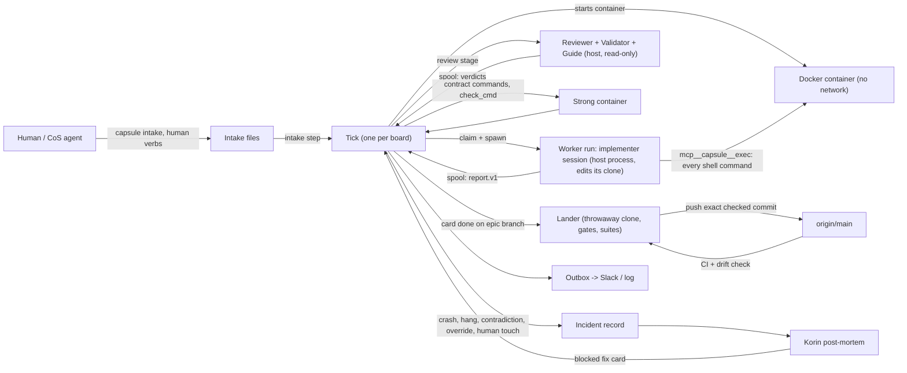
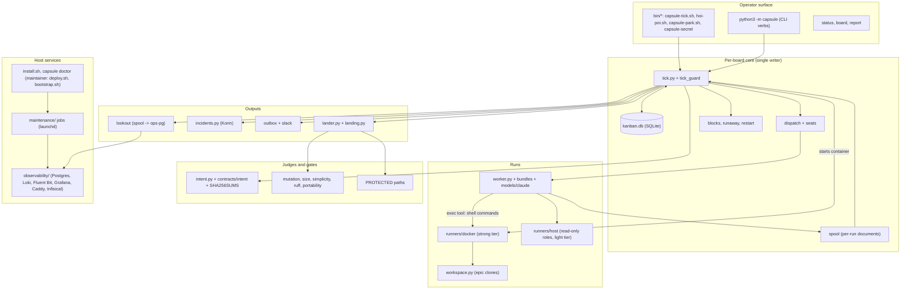

# Capsule: system overview (high-level design)

Status: audited against `main` @ `f1f54a228` plus docs commits, 2026-11-27. Low-level detail is in
[components/](components/); the file-to-page map is [inventory.md](inventory.md).

## TL;DR

Capsule is a small, single-machine software factory run by one maintainer. A human or the
chief-of-staff (CoS) agent files a **card**. One **tick** process per board, the only writer of
that board's SQLite file, starts model **runs** for ready cards. The tick itself never calls a
model. On the default strong tier the implementer's commands run in a no-network container; reviewers judge on the host; the **lander**
re-checks the change in a throwaway clone and, in `land` mode, pushes it to `origin/main` (a new board has no `lander.mode`, so the lander is off; `dry-run` runs the checks and pushes nothing). Every failure becomes an
**incident** that must end in a fix and a test. Reliability rules (Zenkai) bind every agent.

## Purpose

- Turn written cards into reviewed, tested commits on `main` with the maintainer's time spent on
  judgement calls only.
- Stay thin around the model: machinery is stdlib Python and a few shell scripts so a stronger or
  weaker model does not break it (`docs/PRODUCT.md`).
- Be safe by construction: the commands the code-writing agent runs have no network, it cannot edit its own
  judges, and cannot land its own work.

## The loop

1. **Intake.** `python3 -m capsule intake <board> ...` or a cross-board file drop
   (`capsule/intake.py`, `capsule/cli_intake.py`). Human verbs (`capsule human`) write one JSON file
   per intervention (`capsule/human.py`). See [intake](components/intake.md).
2. **Tick.** `Tick.once` in `capsule/tick.py` (`Tick` composes the `TickRuns`, `TickReview` and
   `TickRulings` mixins from `tick_runs.py`, `tick_review.py`, `tick_rulings.py`) runs a fixed step
   order: outbox digest, interventions and intake, reap orphans, timeouts and leases, close
   finished runs from their spool, stall-continue and queued `stop`, review stage, guide rulings,
   incidents, epic sync, dispatch, blind-tester dispatch, metrics, the stall supervisor (with the
   Z5 detectors), image requests, landing, boundary restart, then outbox flush, heartbeat and the
   Lookout timeline. See [tick-scheduler](components/tick-scheduler.md).
3. **Runs.** `capsule/worker.py` (`python3 -m capsule run-one`) builds the role's prompt bundle,
   calls the model adapter and writes schema-checked documents to the run's spool. Only the tick
   applies them. See [worker-runner-and-images](components/worker-runner-and-images.md).
4. **Review.** After the implementer reports `done`, the tick starts reviewer, validator and guide
   (`REVIEW_ROLES`, plus `security` when `redesign.security_review` is on and a blind tester when
   `redesign.blind_tests` is on, see [blind-path](components/blind-path.md)), gates the verdicts through the intent examples and in-tick checks, and decides
   pass, fix round, block or triage. See [gate-review-checks](components/gate-review-checks.md).
5. **Land.** `capsule/landing.py` (behind `lander.mode`: unset means off, `dry-run` checks only, `land` pushes) calls `capsule/lander.py`:
   fetch, sync, protected paths, gates, suites in a sandbox container, the blind re-run (gate mode),
   deploy check; in `land` mode it pushes exactly the commit it checked (a product board lands on a
   day branch, see [product-board-landing](components/product-board-landing.md)). See [lander-and-keeper](components/lander-and-keeper.md).
6. **Incidents.** Crashes, hangs, contradictions, overrides and human interventions open incidents;
   Korin writes the post-mortem; closure needs a fix card, a decision row, a note and a new
   recurrence test that passes on `main`. See [incidents-korin-flow](components/incidents-korin-flow.md).

## Component map

## Data stores

| Store | Where | Written by | Notes |
|---|---|---|---|
| Board DB | `$CAPSULE_HOME/boards/<board>/kanban.db` (SQLite; default home `~/.local/share/capsule`, `capsule/paths.py`) | the board's tick only | Tables: `tasks`, `task_links`, `task_comments`, `task_events`, `task_runs`, `task_attachments`, `kanban_notify_subs` (base schema `capsule/board_schema.sql`, inherited from the earlier prototype's kanban) plus `outbox`, `outbox_key`, `slack_msg`, `guard_state`, `thread_owner`, `requests`, `incidents`, `app_event_seen` (`capsule/db.py`). |
| Board config | `boards/<board>/config.json` | the operator | Reloaded every pass (`capsule/config.py`); a bad reload keeps the last good config. |
| Run spool | `boards/<board>/spool/<run_id>/` | workers write documents; the tick archives them | `request`, `report`, `decision` documents, `job.json`, `run.json`, `worker.log`, `journal.jsonl`. |
| Image record | `$CAPSULE_HOME/images.lock` | `capsule image build`, `docker/build-base.sh` (the maintainer's record is `docker/IMAGES.lock`) | One digest row per board and layer; the runner starts only a recorded image ([image-record](components/image-record.md)). |
| Blind repo | a per-board sibling repo (`blind_tests.repo`) | the blind-tester run and host git only | Never mounted into the implementer ([blind-path](components/blind-path.md)). |
| Epic clones | `boards/<board>/work/<branch-slug>/`, git dirs in a sibling `.gitdirs/` | the tick (`capsule/workspace.py`) | One clone per epic, reused across runs. |
| Human and intake files | `boards/<board>/human/`, `boards/<board>/intake/` | operator CLI; other boards' ticks | One JSON file each; the board's own tick ingests them. |
| Outbox log | `boards/<board>/outbox.log` plus the `outbox` table | the tick | Durable queue; senders: file log, Slack. |
| Lookout spool | `$CAPSULE_HOME/lookout/<board>/spool.jsonl` (a per-board tick; `lookout/spool.jsonl` otherwise) | `capsule/lookout.py` | Shipped to ops-pg by `capsule/lookout_ship.py`. |
| Keeper queue | `$CAPSULE_HOME/queue/<repo>/owners.json` | `bin/capsule-own` | Branch ownership read by the lander and `capsule unblocked`. |
| Maintenance state | `~/.local/state/capsule-corp/maint` (`AGENT_OPS_STATE_DIR`) | `maintenance/` scripts | Events spool, heal state, guard modes and logs. |
| ops-pg and Loki | Docker volumes of the observability stack | Lookout shipper, probe, Fluent Bit | Dashboards read them. |
| Vault | `$OBSIDIAN_VAULT_PATH` (an optional notes folder) | Korin notes, vault jobs, CoS | Decision rows, `Knowledge/Incidents/`, specs. Read by dispatch only as pushed text. |
| Secrets | Infisical, reached through `bin/capsule-secret`; local files under `~/.config/capsule/` | operator | Never read by agents; see [secrets](components/secrets.md). |

## Trust boundaries

- **The tick never calls a model** and never runs worker-influenced code on the host. Models run
  only in worker processes it spawns (`capsule/tick.py` module docstring, `capsule/worker.py`).
- **Implementer commands in a container.** The tick starts one hardened Docker container per run (the strong tier). The model session (`claude -p`) runs on the host and edits its own clone. Its edits are limited to that clone; Capsule does not confine its file reads. Every shell command it runs goes into the container through the `mcp__capsule__exec` tool. The container has
  `--network=none`, `--cap-drop ALL`, `no-new-privileges`, tmpfs scratch, `--user uid:gid`, memory,
  pids and cpu limits (`capsule/runners/docker.py`). The git dir lives outside the mount
  (`workspace.gitdir`). With `redesign.blind_tests` on, host sessions also run under a host wall
  that denies reads of the blind tests (`capsule/runners/host_wall.py`). A light tier (macOS seatbelt, `capsule/runners/seatbelt.py`) exists behind
  `redesign.light_runner`.
- **Judges on the host, read-only.** Reviewer, validator, guide and Korin run on the host runner
  with read-only tools and no lease (`READONLY_ROLES`).
- **Single writer.** One exclusive file lock per board (`capsule/tick_guard.py`).
- **Documents, not actions.** A worker's output is a schema-checked file; the tick validates and
  applies it (`capsule/spool.py`, `capsule/jsonschema.py`). Symlinks a worker plants are not
  followed (`capsule/safe_write.py`).
- **Protected paths.** A worker's change may not touch contracts, intent examples, the Zenkai
  mirror, the lander, the workspace code, image inputs and other judge paths
  (`workspace.PROTECTED`; the lander turns a hit into a hold for the maintainer's stamp). See
  [gate-protected-paths](components/gate-protected-paths.md).
- **Host git hardening.** Every host git call pins `core.hooksPath=/dev/null`,
  `core.fsmonitor=false`, no credential helper and no `ext` transport (`workspace.HARDENING`).
- **Secrets stay out of agents.** The secret-read guard (a maintainer-only hook, not in the public edition) refuses (block mode, default since D215) tool calls that read
  secret files; the implementer container has no secrets and no network
  ([secret-read-guard](components/secret-read-guard.md)). That guard covers the owner's sessions only. Card workers read only their clone and `add_dirs`, enforced by `--restricted`, the permission default and `capsule/read_guard.py` ([read-guard](components/read-guard.md)).
- **Compose live guard.** Mutating compose commands on the live stack are refused unless the
  environment file is the real one ([compose-live-guard](components/compose-live-guard.md)).

## External services

| Service | Used for | Where |
|---|---|---|
| Claude Code (`claude -p`) | the only implemented model runner | `capsule/models/claude.py` |
| Slack Web API | notifications (`chat.postMessage`, `chat.update`) | `capsule/slack.py` |
| GitHub | `origin` for push, `gh` for CI conclusion (read-only) | `capsule/landing.py`, `capsule/ci_watch.py` |
| Docker | strong runner, observability stack | `capsule/runners/docker.py`, `observability/docker-compose.yml` |
| launchd | tick jobs and maintenance jobs | `launchd/templates/`, `bin/capsule-tick.sh` |
| Postgres, Loki, Fluent Bit, Grafana, Caddy | observability | `observability/` |
| Infisical | secrets server | `bin/capsule-secret`, `maintenance/lib_compose.sh` |
| Tailscale | phone access to Grafana | maintenance/tailnet_serve.sh (maintainer only, not in the public edition) |
| Ollama | vault semantic search (author overlay, not shipped) | local server, not part of the public edition |

## Deployment on the Mac

- One KeepAlive launchd job per board runs `python3 -u -m capsule tick --replace --board <b>`
  (`launchd/templates/__PREFIX__.capsule-tick-*.plist`); `bin/capsule-tick.sh {start|stop|restart|status} <board>`
  controls them. After code lands, the boundary step restarts the tick onto the new code.
- Public path: `./install.sh` sets up a fresh Mac and `capsule doctor` checks it (see
  [SETUP.md](../SETUP.md)). The maintainer also uses deploy.sh and bootstrap.sh (maintainer
  only, not in the public edition): deploy.sh renders templates and registers plists, and
  `deploy.sh --check` reports drift and writes nothing. `bin/hoi-poi.sh` is the one-switch cold
  start and shutdown. See [deploy-and-drift](components/deploy-and-drift.md).
- Custodial jobs (heal every 5 min, backup nightly, restore-verify, cleanup, obs-probe every 10 min,
  live-snapshot every minute, disk-relief every 4 h; keeper-watch every 15 min is install-only) are launchd calendar or interval jobs; see
  [maintenance-jobs](components/maintenance-jobs.md).
- The observability stack runs in Docker Compose (`observability/docker-compose.yml`).
- Launchd label prefix of the `capsule-*` jobs is resolved by `bin/lib_prefix.sh`: env `CAPSULE_LAUNCHD_PREFIX`, else `host.json` `launchd.label_prefix`, else `dev.capsule`.
- The maintainer's personal note-keeping and `ollama-serve` jobs are an author overlay and do not ship.

## Design rules (summary)

Reliability first (Zenkai, [zenkai](components/zenkai.md)); thin around the model; one pane per
kind of information; an implementer whose commands run with no network; every check has two independent oracles (Z2); no new
class, function or config key without two real callers (Z8).
