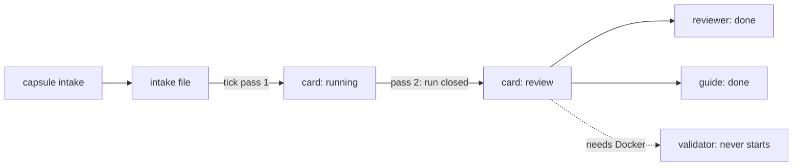

# Walkthrough: one card, without Docker or a Claude login

This page runs a real card through a real tick on a laptop that has no Docker and no model login.
It uses the stub model adapter. You see the board file, the events and the run rows. The output
below was captured from a real run at the head of branch `build/alpha-docs` (commit 0a506b5a8,
2026-11-27) on macOS, and trimmed.

## TL;DR

- You can run a whole tick, a dispatch and a worker process with the stub adapter and the light
  runner tier. No Docker and no `claude` login are needed.
- A routing entry with `"adapter": "stub"` may carry a `reports` list of canned reports. The worker
  fills `run_id`, `task_id` and `claim_lock` into each one from the current run.
- With canned reports for the implementer, the reviewer and the guide, the card goes
  `ready` -> `running` -> `review`. The implementer run, the reviewer run and the guide run all close
  `done`. The card then **stops in `review`**: the validator needs the strong runner tier, and that
  tier needs Docker (see "Where it stops").



## What you need

| Need | Why |
|---|---|
| Python 3 and a checkout of this repo | The commands are `python3 -m capsule ...` run from the repo root. |
| `git` | The tick clones the board's repo into an epic clone. |
| macOS with `/usr/bin/sandbox-exec` | The light runner tier uses it. Without it a light card waits (`runners/host.py`). |
| `sqlite3` | Only to look at the board file. |

## Steps

Use a temporary folder for everything. Set `HOME` and `CAPSULE_HOME` to it so nothing touches your
real state. `AGENT_OPS_NO_LAUNCHCTL=1` stops the tools from touching launchd jobs.
`AGENT_OPS_NO_DOCKER=1` marks Docker as absent (`runners/docker.py`), as it is on a laptop without it.

### 1. Set up a temporary home and a source repo

The board needs a repo whose epic branch already exists. The tick checks out `epic/demo`; if the
branch is missing the first pass fails with `pathspec 'epic/demo' did not match`.

```sh
W=$(mktemp -d)
mkdir -p "$W/home" "$W/capsule" "$W/repo"
export HOME="$W/home" CAPSULE_HOME="$W/capsule" AGENT_OPS_NO_LAUNCHCTL=1 AGENT_OPS_NO_DOCKER=1
G="git -C $W/repo -c user.email=dev@example.com -c user.name=dev"
$G init -q -b main
echo "# demo" > "$W/repo/README.md"
$G add README.md && $G commit -q -m init && $G branch epic/demo
```

### 2. Create the board

```sh
python3 -m capsule board new demo --repo "$W/repo"
```

Output (trimmed):

```
wrote $W/capsule/boards/demo/config.json
wrote $W/capsule/boards/demo/kanban.db
note: Slack is off (--notify turns it on)
note: default contract checks (--check CMD replaces them):
  ruff check --select E9,F .
  python3 -m unittest discover -s tests -p 'test_*.py' -t .
  python3 -m unittest discover -s tests/ui -t .
next:
  ...
```

`board new` writes the config and the board file `kanban.db`, so no other setup step is needed.

### 3. Select the stub model and the light tier

Edit `$CAPSULE_HOME/boards/demo/config.json`:

- In every entry of `routing`, add `"adapter": "stub"`. `config.route` returns
  `adapter = entry.get("adapter", entry["provider"])`, and `models.adapter_for` builds a
  `StubAdapter` for the name `stub`.
- In the entries of the four roles that run (`implementer`, `reviewer`, `validator`, `guide`), add a
  `reports` list of canned reports. The stub returns the next entry of the list on each run, and
  `reports` is allowed only with `"adapter": "stub"`. The worker fills `run_id`, `task_id` and
  `claim_lock` (see "Writing canned reports"). The shapes come from `capsule/tests/test_tick.py`
  (`IMPL_DONE`, `REV_PASS`, `VAL_PASS`, `GUIDE_OK`) and `contracts/schemas/`:

  ```json
  "implementer": {"adapter": "stub", "reports": [{"schema": "report.v1", "role": "implementer",
    "status": "done", "implemented": ["added hello to README.md"], "left_undone": [],
    "commands": [{"cmd": "make test", "exit": 0}], "issues": [],
    "procedures_followed": ["tdd"]}]},
  "reviewer": {"adapter": "stub", "reports": [{"schema": "review_verdict.v1", "role": "reviewer",
    "verdict": "pass", "findings": [], "not_reviewed": [], "simplicity": ["a", "b", "c", "d", "e"]}]},
  "validator": {"adapter": "stub", "reports": [{"schema": "validator_result.v1", "verdict": "pass",
    "assertions": [{"cmd": "make test", "exit": 0, "result": "pass"}], "not_run": []}]},
  "guide": {"adapter": "stub", "reports": [{"schema": "alignment_verdict.v1", "verdict": "aligned",
    "rows": [], "reason": "fits the card"}]}
  ```

  Keep the other keys of each entry (`provider`, `model` and so on).
- Set `redesign.light_runner` to `true`. The strong tier needs Docker. The light tier runs the
  implementer under the macOS seatbelt on the host.

### 4. File a card

```sh
echo 'Add a line to README.md. Done when: README.md contains the line "hello".' > "$W/card.md"
python3 -m capsule intake demo --title "Add a README line" --body-file "$W/card.md" \
    --assignee dev-frontend --epic epic/demo --runner light
```

Output: one intake id, such as `rq_2f97c01b`. This only writes a file under
`boards/demo/intake/`. `--assignee` must be a name in the config `assignees` map that routes to
`implementer`; `--epic` must be one of the config `epics`.

### 5. Run tick passes

```sh
for i in 1 2 3 4 5 6 7 8; do python3 -m capsule tick --once --board demo; sleep 5; done
```

Each pass prints a JSON line of counts, then the card status (from `select id,status,tier,failure_count from tasks`).
The main counts and the status after each pass:

```
pass 1: intake 1                      t_7559a988|running|light|0
pass 2: closed 1, review_runs 2       t_7559a988|review|light|0
pass 3: closed 2                      t_7559a988|review|light|0
pass 4 to 8: all counts 0             t_7559a988|review|light|0
```

Pass 1 ingests the card and dispatches the implementer. Pass 2 closes the implementer run from its
spool, moves the card to `review` and starts two review runs (the reviewer and the guide). Pass 3
closes both. After that nothing moves. (The sleep gives the detached `run-one` process time to
finish.) Each pass also prints `usage_meter: meter unavailable`, because the temporary home has no
`config.json`. This is harmless.

### 6. Watch status and events

```sh
sqlite3 -header "$CAPSULE_HOME/boards/demo/kanban.db" \
  "select id,kind,substr(payload,1,110) from task_events
   where kind not in ('eval_check','claimed','run_closed','created');"
```

```
id|kind|substr(payload,1,110)
3|intake_ingested|{"intake_id": "rq_6bcdd674", "kind": "card", "fingerprint": "card", "source_board": "operator", ...
15|request_review|{"run_id": "949a8788b2e841708f28ce2eddd5a82a"}
17|review_started|{"role": "reviewer", "run_id": "ac254cabcbb34d05a0e49ad4bb7f81a8"}
18|review_started|{"role": "guide", "run_id": "f2f4fce006614e42b3e9d3c0e795b0aa"}
```

There is no `review_started` for the validator, and no failure event. The runs:

```sh
sqlite3 -header "$CAPSULE_HOME/boards/demo/kanban.db" \
  "select id,profile,status,outcome,runner,error_class,error from task_runs;"
```

```
id|profile|status|outcome|runner|error_class|error
1|implementer|done|completed|light||
2|reviewer|done|completed|host||
3|guide|done|completed|host||
```

The outbox log (`boards/demo/outbox.log`) holds the message a human would see:

```
capsule: t_7559a988 filed by intake rq_6bcdd674 (card), ready on epic/demo: Add a README line
t_7559a988 dispatched: implementer on claude-sonnet-5 | branch: epic/demo
```

The dispatch line names `claude-sonnet-5` because that is the `model` field of the route. The
adapter that ran was the stub.

## Writing canned reports

- The worker fills only `run_id`, `task_id` and `claim_lock`, and only for a report that has a
  `schema` field (`capsule/worker.py`, `_stub_ids`).
- The entry must hold everything else the schema requires. `report.v1` and `review_verdict.v1`
  need `role`. `validator_result.v1` and `alignment_verdict.v1` have no `role` field and refuse
  extra fields, so do not add one there. Each schema also has its own content fields (see
  `contracts/schemas/`). The entries in step 3 are valid.
- An entry that sets its own `run_id`, `task_id` or `claim_lock` keeps them. Ids copied from an
  earlier run are wrong for the new run, so the tick refuses the report. A second board whose
  implementer entry held the ids of the run above gave:

  ```
  id|profile|status|outcome|error_class|error
  1|implementer|failed|failed|invalid_output|report envelope does not match the run (run_id/task_id/claim_lock)
  2|implementer|failed|failed|invalid_output|report envelope does not match the run (run_id/task_id/claim_lock)
  ```

  The check is in `capsule/tick.py:746`. Leave the three ids out of the entry.

## What each stage proved

| Stage | What you saw | Code |
|---|---|---|
| Intake | `intake: 1`, then `intake_ingested` and a card with status `ready` and tier `light` | `capsule/intake.py`, `capsule/db.py` (`new_task`) |
| Dispatch | event `claimed`, run row `running` | `capsule/dispatch.py`, `capsule/lease.py` |
| Worker | a `run-one` process ran the stub and wrote the report with the run's ids filled in | `capsule/worker.py` (`run_one`, `_stub_ids`), `capsule/models/stub.py` |
| Close | `closed: 1`, event `run_closed`, run row `done` / `completed`, card `review` | `capsule/tick.py` (the `closed` count) |
| Review | `request_review`, then `review_started` for `reviewer` and `guide`; both run rows `done` on the `host` runner | `capsule/tick.py` (`_start_reviews`) |

## Where it stops, and why

The card stays in `review` and the validator never starts. This is the exact reason:

1. `_start_reviews` (`capsule/tick.py:790`) loops over the review roles. For `validator` it
   calls `dispatch.tier_down(..., checks=True)` (`capsule/tick.py:799-800`).
2. With `checks=True`, `tier_down` (`capsule/dispatch.py:274-278`) asks for the `strong` tier, even
   when the card is `light`. The validator's contract commands run in a container.
3. `strong` is in `host_tiers` only when Docker is up (`capsule/tick.py:201`). With
   `AGENT_OPS_NO_DOCKER=1` (`capsule/runners/docker.py:495`) it is not, so the loop skips the
   validator with `continue`: "a strong (or mac) need waits, never falls back". It writes no event.
4. The card needs a validator report before it can pass, so it waits in `review`. The landing step
   was not reached. This page ran no step after this.

To take a card past this point you need a machine where Docker is running. The test
`TickCase.test_happy_card_reaches_done` (`capsule/tests/test_tick.py`) uses a fake runner for the
strong tier, and ends with the card `done` and four runs (implementer, reviewer, validator, guide).
The lander also needs Docker for its suites. Without it the lander holds with `lander_wait_docker`,
and the board stays in `dry-run` mode by default (`lander.mode`).

## Clean up

Delete the temporary folder when you are done. `run-one` may leave read-only `worker.log` files, so
`chmod -R u+w "$W"` first.
